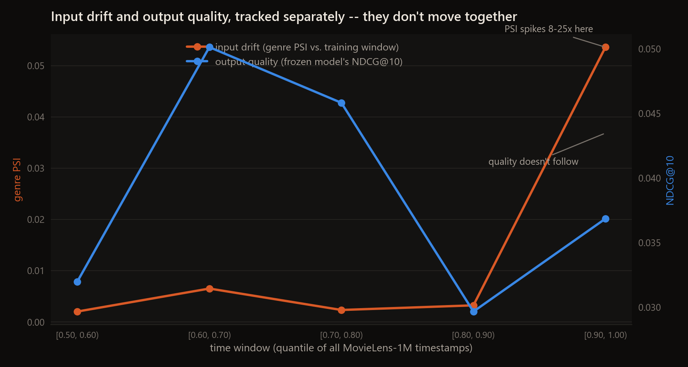

<div align="center">

# Sentinel

**Production ML monitoring for a real recommender: input drift and output quality, tracked separately -- because measuring one is not the same as measuring the other, and this repo shows you a case where they disagree.**




</div>

A dashboard that only shows "has the input distribution changed" is answering a proxy question, not the one that
actually matters for a deployed model ("did it get worse"). This repo monitors a real, already-trained recommender
([`compass-recsys`](https://github.com/EllE961/compass-recsys)) on real temporal data (MovieLens-1M's actual
timestamps, not a synthetic drift simulation) and tracks both signals side by side -- and in the one real spike
this dataset produces, **the two genuinely disagree**.

## The setup

- **The monitored model:** EASE (Steck, 2019), a closed-form item-item recommender from `compass-recsys`'s own
  model lineup, fit once on the first half of MovieLens-1M's 1,000,209 ratings and then frozen -- it never sees
  anything after that cutoff again. This mirrors a real production model that's been deployed and not retrained.
- **Output quality, every window:** NDCG@10 and Recall@10, computed with `compass-recsys`'s own full-ranking
  evaluation code (`compass.metrics.evaluate`), on that window's real held-out next-interaction targets.
- **Input drift, every window:** the Population Stability Index (PSI) between the window's genre distribution
  (which genres people actually watched) and the training window's genre distribution. PSI is the standard
  input-drift statistic in production monitoring -- see `sentinel/drift.py` for the implementation and the
  Jeffreys-divergence identity that makes it provably non-negative (checked by a test, not just asserted).
- **Five real sequential windows** after the training cutoff, each the real timestamps of ~100,000 ratings, no
  synthetic perturbation anywhere in this repo.

## Result

| window (quantile of all timestamps) | n interactions | genre PSI | NDCG@10 | n evaluated |
|---|---|---|---|---|
| [0.50, 0.60) | 100,024 | 0.0020 | 0.0320 | 184 |
| [0.60, 0.70) | 100,020 | 0.0065 | 0.0501 | 106 |
| [0.70, 0.80) | 100,020 | 0.0023 | 0.0458 | 411 |
| [0.80, 0.90) | 100,024 | 0.0032 | 0.0297 | 520 |
| **[0.90, 1.00)** | 100,020 | **0.0536** | 0.0368 | 1,175 |


Reading this straight: genre PSI sits at 0.002-0.0065 for four windows in a row, then **jumps 8-25x to 0.0536 in
the final window** -- a real, measurable shift in what people watched, not noise. NDCG@10 over the same five
windows is 0.032, 0.050, 0.046, 0.030, 0.037: noisy, but in the *same range* in the drift window as everywhere
else. **An input-drift alarm would have fired loudly in the last window. A quality-tracking alarm would not have.**

Neither reading is wrong. They're different questions. A monitoring system that only asks the first one would have
raised a real alert about a real distribution shift that, on this evidence, didn't cost the model anything it
wasn't already losing elsewhere (NDCG@10 is noisy throughout, not uniquely bad in the drift window). A system that
only asks the second one would have missed a genuine, 8-25x change in its traffic entirely. That gap is the reason
this repo tracks both instead of picking one as a proxy for the other.

## Why this design

**A real recommender, real timestamps, no synthetic drift.** It would have been easy to fabricate a distribution
shift and show the dashboard catching it. The harder and more honest version asks whether a real, already-trained
model on real data shows anything interesting at all -- and reports what's actually there, which turned out to be
more specific (and more useful) than a clean "drift causes degradation" story would have been.

**EASE, not the full two-tower + LightGBM stack.** `compass-recsys`'s best system needs its two-tower retriever and
ranker trained together; freezing it at an arbitrary cutoff would mean partially retraining it, not monitoring it.
EASE is a single closed-form fit (~1 second on the full dataset) with a real `.score()` method, which makes "fit
once before cutoff, never touch again" a clean, honest operation rather than an approximation of one.

**PSI on genres, not on raw ratings or user ids.** Genres are the one feature in this dataset with a fixed,
interpretable, bounded vocabulary (18 categories) -- exactly the shape PSI is designed for. A drift metric on raw
item ids would mostly measure catalogue turnover, which MovieLens-1M's fixed catalogue doesn't have.

## Repository map

```
sentinel/
  drift.py      PSI and genre-distribution helpers -- pure functions, tested without any data
  quality.py     wraps compass-recsys: fit a frozen EASE model, score a real temporal window
  pipeline.py     the sweep: one fit, five windows, drift + quality for each
  evaluate.py      CLI -> results/sweep.json
scripts/make_figures.py  renders the chart above from results/sweep.json
tests/            PSI's mathematical properties (non-negative, symmetric, zero iff identical),
                  plus pipeline integration tests on compass.data.synthetic() (no download, fast CI)
```

## Quickstart

Needs [`compass-recsys`](https://github.com/EllE961/compass-recsys) installed, with MovieLens-1M downloaded
(`python -m compass.data` on first use handles that automatically).

```bash
pip install "compass-recsys @ git+https://github.com/EllE961/compass-recsys.git"
pip install -e ".[dev]"

make test       # 9 tests, synthetic data, no download, runs in CI
make eval         # the real sweep on MovieLens-1M -> results/sweep.json
make figures        # the chart above -> docs/assets/
```

## Limitations and next steps

- **One drift feature (genre), one frozen model (EASE), one dataset.** The genuinely interesting finding here --
  drift and quality decoupling -- is a real, measured observation on this specific setup, not a general claim that
  they always will. A natural next step is adding a second drift feature (e.g. release-year distribution, or
  rating-volume-per-user) and checking whether it decouples the same way or differently.
- **Five windows is a short monitoring history.** A longer MovieLens span (ML-20M, say) would let the sweep show
  whether the final window's PSI spike is a one-off tail effect of this dataset ending, or an early look at a
  trend that continues -- this repo can't tell those apart from five points, and doesn't claim to.
- **No automated alerting thresholds are implemented.** The README's "would have fired" language describes what a
  simple threshold rule would do, not a rule this code actually runs. Wiring one up (e.g. page when PSI exceeds
  its own trailing 95th percentile) would be the natural step from analysis to an actual monitor.

## References

- Steck, H. (2019). *Embarrassingly Shallow Autoencoders for Sparse Data* (EASE) -- the model this repo freezes
  and monitors.
- The Population Stability Index is standard practice in credit-risk and recommender monitoring; see any
  production ML monitoring reference (e.g. Evidently AI's documentation) for the PSI threshold conventions this
  repo deliberately avoids treating as a universal law -- see `sentinel/drift.py`'s docstring.

## License

MIT, see [`LICENSE`](LICENSE).
